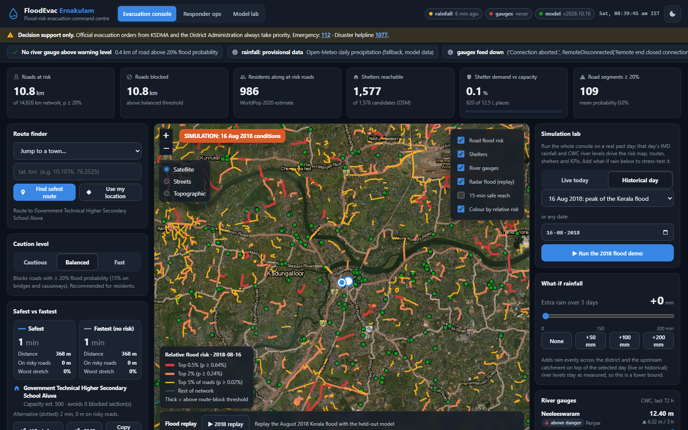
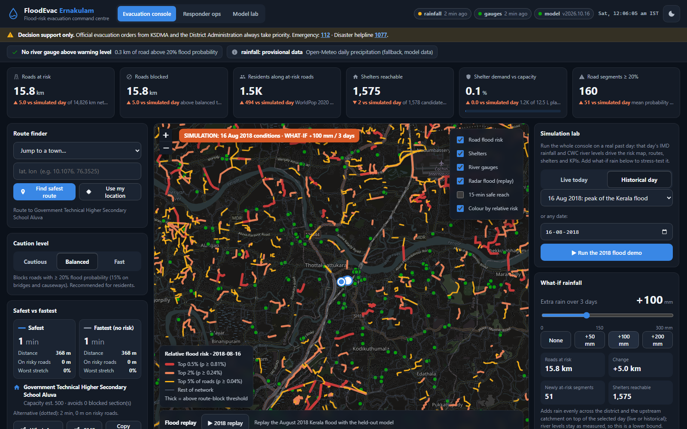
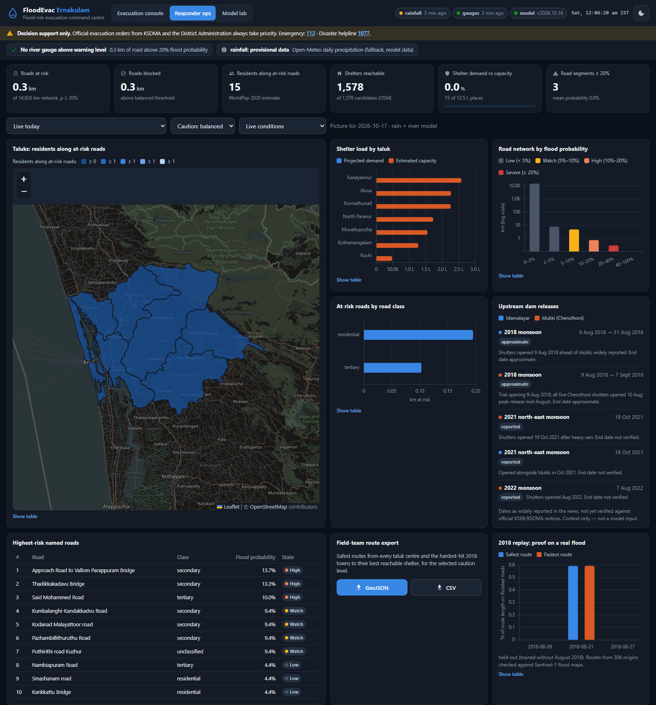
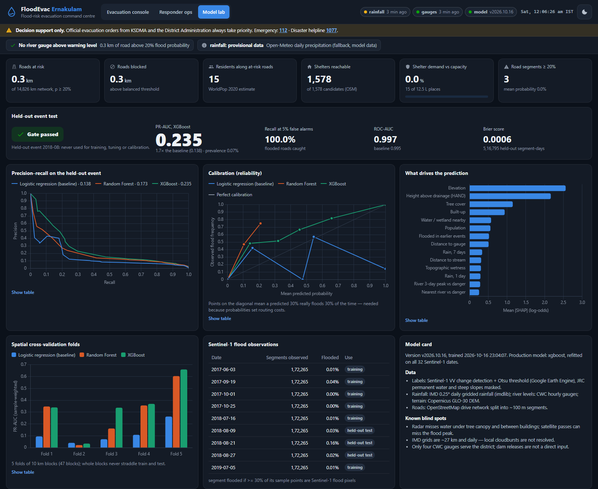
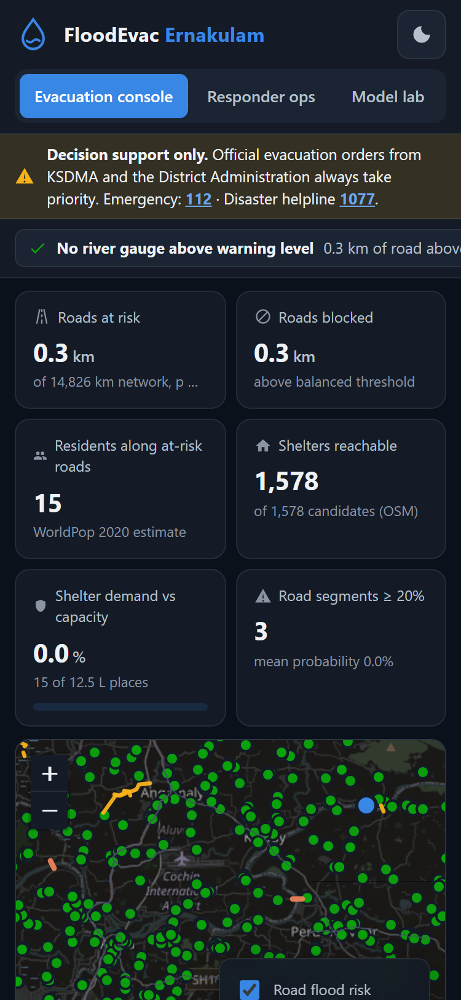

# FloodEvac Ernakulam — Flood Evacuation Route System

FloodEvac turns a flood alert into a specific instruction: **the safest drivable route from where you are to a
reachable shelter, updated as rain and river levels change.** It covers the Ernakulam district pilot (seven taluks,
Periyar and Muvattupuzha basins) for residents and responders.

Three parts:

| Part | What it does |
|---|---|
| **Predict** | A calibrated machine-learning model scores every ~100 m road segment for the probability that it is under water, from terrain, land cover, IMD rainfall (local and upstream) and CWC river levels. It was trained on flood maps built from Sentinel-1 radar. |
| **Route** | A risk-weighted road graph sends vehicles around flooded roads to the best reachable shelter. Every refresh runs a reverse multi-source Dijkstra; point-to-point routes use A\*. |
| **Deliver** | A Flask web app with a map-first evacuation console, a responder operations view and a model lab. |

> **Decision support only.** Official evacuation orders from KSDMA and the District Administration always take
> priority.



## Dashboard

| View | Widgets |
|---|---|
| **Evacuation console** `/` | KPI strip · live road-risk map with layer toggles (probability or relative-risk colouring) · **Simulation lab: run everything on a real past flood day (e.g. the 16 Aug 2018 peak)** · route finder (tap / GPS / town / coordinates) · caution slider · safest-vs-fastest card · nearest shelters with capacity bars · river-gauge sparklines vs warning/danger · district rainfall + forecast · data-feed health · what-if rainfall simulator · August 2018 replay timeline · explain-this-road popup (SHAP) · 15-minute safe-reach isochrone · reroute alert · WhatsApp/SMS share · offline PWA |
| **Responder ops** `/responder` | Taluk choropleth of residents along at-risk roads · shelter load by taluk · road network by flood probability · at-risk roads by class · dam release timeline · riskiest named roads · field-team route export (GeoJSON/CSV) · 2018 replay proof |
| **Model lab** `/model` | Held-out-event gate · precision-recall curves · calibration · SHAP drivers · spatial-CV folds · Sentinel-1 events · model card |

Every chart has a "Show table" view. The UI has dark and light themes and is mobile-first (checked at 375 px).

## Quick start

**Easiest:** double-click `start.bat`. It sets up Python on first run, starts the server and opens
http://localhost:8000 after about 40 seconds, while the first live refresh runs.


Requirements: Python 3.11. Docker is optional.

```powershell
python -m venv .venv
.\.venv\Scripts\Activate.ps1
pip install -e ".[pipeline,dev]"
```

**Option A: use the released data** (no Earth Engine account needed):

```powershell
.\scripts\fetch_data.ps1 -Url <release asset URL of floodevac-data-vX.zip>
python -m floodevac.api.app          # http://localhost:8000
```

**Option B: rebuild everything from source data:**

```powershell
earthengine authenticate             # once
copy .env.example .env               # set EE_PROJECT to your Earth Engine Cloud project
.\scripts\pipeline.ps1               # osm, dem, layers, sar, rain, gauges, shelters, features, graph, train, replay
python -m floodevac.api.app
```

**Docker** (after option A or B):

```powershell
docker compose up --build            # http://localhost:8000
```

Without data the app still starts. It then serves recorded API snapshots and shows a **MOCK DATA** badge.

Tests: `pytest -q`.

## Simulation lab: test it on the 2018 flood

The console can run on any past day from 2017 to 2024 instead of today. **Simulation lab → ▶ Run the 2018 flood demo** loads
16 August 2018, the peak of the Kerala flood. Everything then uses that day's real inputs:

- **Rainfall:** IMD rainfall of 133 mm that day, about 330 mm upstream over 3 days.
- **River levels:** all four CWC gauges were above danger level (Neeleeswaram 12.4 m against a 10.0 m danger level).
- **Map and routing:** the risk map, safest routes from Aluva, shelters, KPIs and the explain popup all run on these inputs.

Other preset days:
- 9, 15, 17 and 21 Aug 2018
- 9 and 10 Aug 2019
- 30 Jul 2024

Testers can add **what-if rainfall** on top of any day, switch caution levels, and tap any road to see why it is at risk.
The Responder view has the same day selector.

The simulation uses the production model, which was trained on all events including 2018. For an unbiased test on
2018, see the **2018 replay** and the Model lab, which use a model that never saw August 2018.

**Colour by relative risk** (map layer toggle) shades the top 5%, 2% and 0.5% of roads for the chosen day. The model
ranks roads very well (ROC-AUC 0.997 on the held-out event), while its absolute probabilities are conservative for
extreme events. Routing always uses the calibrated probabilities.

| What-if on top of 16 Aug 2018 | Responder ops | Model lab | Phone |
|---|---|---|---|
|  |  |  |  |

## Data sources

| Data | Source | Notes |
|---|---|---|
| Roads | OpenStreetMap drive network via `osmnx` | Split into ~100 m segments. Bridges, causeways and road class are tagged. |
| Terrain | Copernicus GLO-30 DEM (AWS open data) | HAND, slope, TWI, stream distance and order via `pysheds`. FABDEM is avoided because of its licence. |
| Flood labels | Sentinel-1 GRD via Google Earth Engine | Change detection + Otsu threshold; JRC permanent water and steep slopes masked. 32 monsoon dates, 2017–2024. |
| Rainfall | IMD 0.25° gridded daily rainfall via `imdlib` | Live: IMD real-time grids (provisional), with Open-Meteo as a labelled fallback. |
| River levels | CWC flood-forecasting portal | Hourly levels for Neeleeswaram (Periyar), Kalampur and Ramamangalam (Muvattupuzha), Arangali (Chalakudy). |
| Land cover, population | ESA WorldCover 2021, WorldPop 2020 (GEE) | Population drives congestion and the people-exposed figures. |
| Shelters | OSM schools, colleges and halls (1,578 with ≥ 200 estimated places) | Capacity is estimated from building footprint. Marked unverified until the DDMA list arrives. |
| Dam releases | `data/reference/dams.csv` | Dates as widely reported in the news, not yet verified against official KSEB/KSDMA notices. Shown as context only, never as a model input. |

## Model quality

The model is tested the way it will be used. **Every Sentinel-1 date of August 2018 is held out** from training,
tuning, calibration and the past-flood feature. Development uses **10 km spatial-block cross-validation**. Results
are reported against a logistic-regression baseline: PR-AUC, recall at a 5% false-alarm rate, Brier score and
reliability curves.

Held-out August 2018 result (from `models/v2026.10.16/metrics.json`):

| Model | PR-AUC | ROC-AUC |
|---|---|---|
| XGBoost | 0.235 | 0.997 |
| Logistic regression baseline | 0.138 | 0.995 |

Prevalence is 0.07%, so XGBoost's PR-AUC is roughly 300× random. The gate passed.

The probabilities are conservative for an event as extreme as 2018. At the 20% block threshold, the model caught
10% of the roads the radar saw flooded, at 62% precision. In the route replay, safest and fastest routes had the
same exposure. Both findings are reported openly in the model card and the replay report.

See [docs/model_card.md](docs/model_card.md) for the measured numbers and
[docs/replay_report.md](docs/replay_report.md) for the August 2018 route replay against radar-observed flooding.

## Routing

Edge cost: `c(e) = t(e) · (1 + α·p(e) + β·k(e))`. The cost is infinite when `p(e) > τ`, and bridges and causeways use a stricter `τ`.

- **Presets:** cautious, balanced and fast (`configs/routing.yaml`).
- **Shelter capacity:** full shelters are penalised and areas are re-assigned.
- **No reachable shelter:** the app says so and directs the user to high ground.

## Project layout

```
configs/            area, model, routing and refresh settings (YAML)
src/floodevac/
  ingest/           osm, dem, sar_gee, imd, cwc, landcover_gee, worldpop, shelters, dams
  features/         terrain sampling, rainfall accumulations, gauge features, table builder
  models/           spatial CV, training, calibration, evaluation, prediction, model card
  routing/          graph, cost, router (Dijkstra / A* / isochrones), engine, 2018 replay
  api/              Flask app factory, routes, services, response schemas
  jobs/             live refresh cycle, QGIS export
web/                templates, CSS, ES-module widgets, vendored Leaflet + Chart.js, PWA
tests/              unit + API contract tests (fixtures are trimmed real API snapshots)
docs/               model card, replay report, API, user guide, data dictionary
qgis/               validation project (floodevac.qgs + GeoPackage)
scripts/            pipeline, release packaging, data download, fixture snapshot
```

## Documentation

- [User guide](docs/user_guide.md)
- [API reference](docs/api.md)
- [Data dictionary](docs/data_dictionary.md)
- [Model card](docs/model_card.md)
- [2018 replay report](docs/replay_report.md)

## Limitations

- **Satellite coverage:** Sentinel-1 radar misses water under tree canopy and between buildings. There was no pass at the 15–17 August 2018 peak.
- **Rainfall resolution:** IMD rainfall is a 27 km daily grid, so the model does not resolve local cloudbursts.
- **River gauges:** only four CWC gauges serve the district.
- **Shelters:** shelters and their capacities are OpenStreetMap-based estimates pending official DDMA data.
- **Landslides:** landslide road blockages are not modelled.
- **Taluk boundaries:** Overpass was unavailable during the build, so taluk boundaries come from GADM 4.1, which has a non-commercial licence. Re-run `python -m floodevac.pipeline osm` with Overpass available before paid use.
- **Basemaps:** satellite imagery and labels come from Esri; street tiles come from OpenStreetMap. Both are free for evaluation, but production traffic needs a licensed tile service (ArcGIS account or a commercial OSM tile provider).
